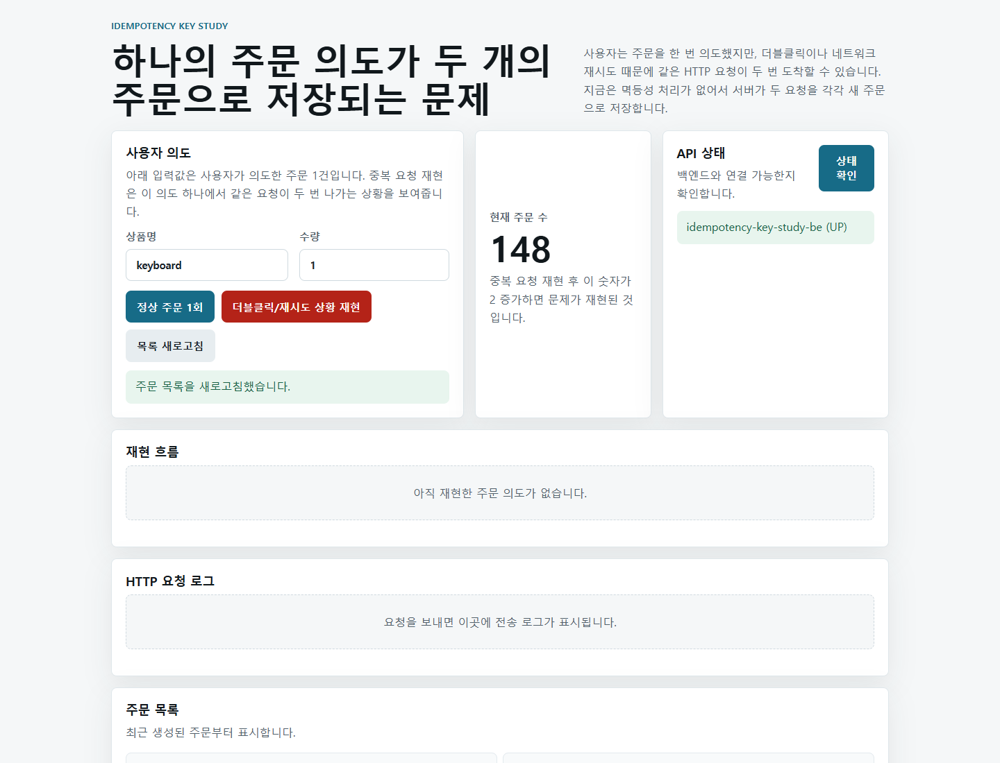
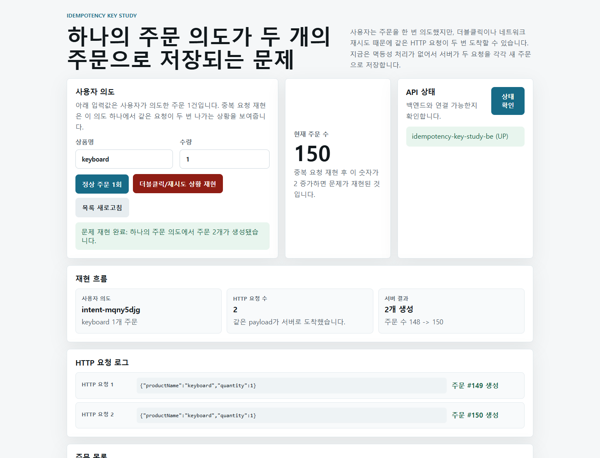

# 1단계: 멱등성 없는 중복 주문 재현 과정

이 문서는 최종 구현 결과가 아니라, Idempotency-Key를 적용하기 전에 문제를 먼저 확인하는 학습 과정이다.

현재 단계의 목표는 "같은 HTTP 요청이 두 번 도착하면 서버가 주문을 두 개 생성한다"는 사실을 직접 확인하는 것이다. 이 문제를 확인해야 이후 Idempotency-Key가 왜 필요한지 설명할 수 있다.

## 현재 구현 상태

백엔드는 주문 생성과 조회 API만 제공한다.

```http
POST /api/orders
GET /api/orders
```

현재 `POST /api/orders`는 멱등성 처리를 하지 않는다. 요청이 들어올 때마다 새로운 주문을 저장한다.

```json
{
  "productName": "keyboard",
  "quantity": 1
}
```

## 재현 의도

이 테스트에서 중요한 것은 사용자가 버튼을 두 번 누르는 행위 자체가 아니다.

확인하려는 상황은 다음과 같다.

```text
사용자 의도: keyboard 1개 주문
네트워크/프론트 상황: 같은 HTTP 요청이 두 번 발생
서버 결과: 주문 row 두 개 생성
```

즉, 사용자는 하나의 주문을 의도했지만 서버는 두 개의 요청을 서로 다른 주문으로 처리한다.

## 재현 전 화면

아래 화면은 중복 요청 재현 전 상태다. 화면에는 사용자 의도, 현재 주문 수, API 상태, 재현 흐름, HTTP 요청 로그가 함께 표시된다.



## 재현 방법

프론트엔드에서 `더블클릭/재시도 상황 재현` 버튼을 누른다.

이 버튼은 하나의 사용자 의도에서 같은 payload를 가진 HTTP 요청 두 개가 발생한 상황을 만든다.

```text
HTTP 요청 1 -> POST /api/orders
HTTP 요청 2 -> POST /api/orders
```

두 요청의 payload는 같다.

```json
{
  "productName": "keyboard",
  "quantity": 1
}
```

## 재현 후 화면

아래 캡처에서는 주문 수가 `148 -> 150`으로 증가했다. 즉, 하나의 주문 의도에서 서버 주문 두 개가 생성됐다.



캡처 시점의 재현 결과는 다음과 같다.

```text
사용자 의도: keyboard 1개 주문
HTTP 요청 수: 2
서버 결과: 2개 생성
생성된 주문: #149, #150
주문 수 변화: 148 -> 150
```

주문 번호와 주문 수는 로컬 DB 상태에 따라 달라질 수 있다. 중요한 관찰 지점은 숫자 자체가 아니라, 같은 의도에서 주문 수가 2 증가한다는 점이다.

## Playwright 확인

문서 이미지는 Playwright로 `http://localhost:5173` 화면을 캡처했다.

확인한 흐름은 다음과 같다.

```text
1. 화면 로드
2. 재현 전 화면 캡처
3. 더블클릭/재시도 상황 재현 버튼 클릭
4. 재현 후 화면 캡처
5. HTTP 요청 로그와 주문 수 증가 확인
```

## 다음 단계

다음 단계에서는 이 문제를 해결하기 위해 서버가 어떤 상태를 저장해야 하는지 살펴본다. 핵심은 같은 사용자 의도에서 발생한 재시도 요청을 구분하기 위한 `Idempotency-Key` 저장 구조를 설계하는 것이다.
